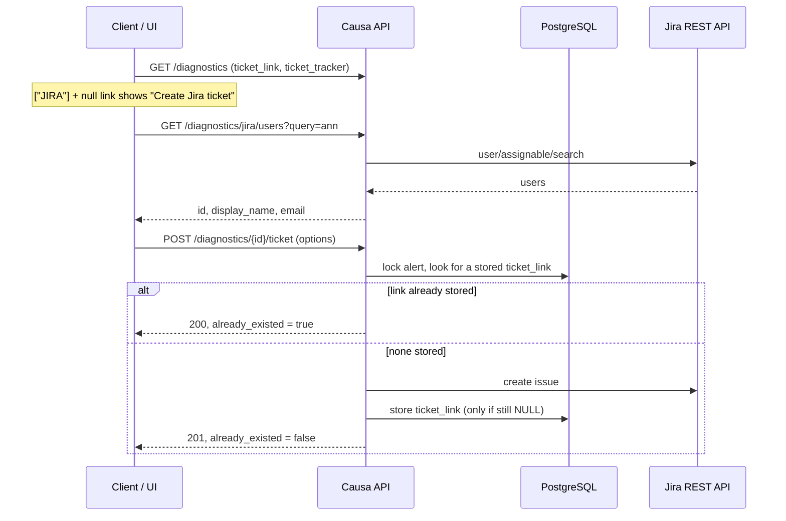

# Jira Integration

Causa can open a Jira ticket from a diagnostic, with an optional assignee, extra description sections and
notes. This guide covers setup, how a ticket is created, and how duplicates are prevented. For request and
response details see the [Diagnostics API](../api/diagnostics-api.md) and
[Configs API](../api/configs-api.md).

---

## Contents

1. [How it works](#how-it-works)
2. [Setup](#setup)
3. [Creating a ticket](#creating-a-ticket)
4. [What the ticket contains](#what-the-ticket-contains)
5. [One ticket per alert](#one-ticket-per-alert)
6. [Reading ticket state from the API](#reading-ticket-state-from-the-api)
7. [Jira Cloud and Server/Data Center](#jira-cloud-and-serverdata-center)
8. [Errors and troubleshooting](#errors-and-troubleshooting)
9. [Security notes](#security-notes)

---

## How it works



The Jira integration is a normal integration config, so it is managed at runtime through the Config API with
no restart. Pods pick up a change through a PostgreSQL notification, so propagation is eventual: a pod whose
listener was disconnected, or had not subscribed yet, when the change was written keeps its previous Jira
config until the next config write or a restart.

---

## Setup

Save a `JIRA` integration config. Only an **active** entry is used.

The two examples below are alternatives. Keep **one** `JIRA` config active at a time. Nothing enforces this:
the Config API allows several named `JIRA` entries (unique per `platform` and `name`) and saving one does not
deactivate the others. Causa does not let the caller choose between active entries. It uses the first one it
finds, and that order is not defined. Deactivate or delete the old entry before activating another, or tickets
and assignee searches may go to the wrong Jira instance or project.

**Atlassian Cloud** (API token):

```bash
curl -X PUT http://localhost:8080/api/v1/configs/integrations/JIRA \
  -H 'Content-Type: application/json' \
  -d '{
    "name": "jira-prod",
    "url": "https://your-org.atlassian.net",
    "is_active": true,
    "auth_config": {
      "authType": "API_TOKEN",
      "username": "bot@example.com",
      "token": "<JIRA_API_TOKEN>"
    },
    "additional_config": { "projectName": "OPS", "issueType": "Bug" }
  }'
```

**Jira Server / Data Center** (personal access token):

```bash
curl -X PUT http://localhost:8080/api/v1/configs/integrations/JIRA \
  -H 'Content-Type: application/json' \
  -d '{
    "name": "jira-onprem",
    "url": "https://jira.example.com",
    "is_active": true,
    "auth_config": { "authType": "PAT", "username": "bot", "token": "<JIRA_PERSONAL_ACCESS_TOKEN>" },
    "additional_config": { "projectName": "OPS" }
  }'
```

| Field | Required | Meaning |
|---|---|---|
| `url` | yes | Jira base URL. Must be `https://`. Plain `http://` is accepted only for `localhost`, `127.0.0.1` and `::1` |
| `auth_config.authType` | no | `PAT` selects Server/Data Center. Any other value, such as `API_TOKEN`, selects Cloud |
| `auth_config.username` | yes | Account email (Cloud, for Basic auth). Required by validation for both flavours |
| `auth_config.token` | yes | API token or personal access token. Encrypted at rest and masked in API responses |
| `additional_config.projectName` | yes | Jira project key, e.g. `OPS`. Must start with a letter; letters, digits and `_` only |
| `additional_config.issueType` | no | Issue type for new tickets. Defaults to `Task` |

The integration user needs permission to create issues and to be shown as an assignee in the project.

Once the config is saved and active, `"JIRA"` appears in `ticket_tracker` on the diagnostics endpoints, which
is how a UI knows to offer a ticket button.

---

## Creating a ticket

1. **Optional:** search for an assignee with `GET /api/v1/diagnostics/jira/users?query=<text>`. It returns
   up to 20 users assignable in the configured project; pass the chosen `id` as `assignee_id`.
2. `POST /api/v1/diagnostics/{id}/ticket`, optionally with a body:

```json
{
  "assignee_id": "5b10ac8d82e05b22cc7d4ef5",
  "include_issue_detail": true,
  "include_recommendations": true,
  "include_implementation_steps": false,
  "additional_notes": "Please look at this today."
}
```

3. The response contains `ticket_link` and `already_existed`. `201` means a ticket was just created; `200`
   means one already existed.

With no body, the ticket description is the root cause and the ticket is unassigned.

---

## What the ticket contains

| Part | Source |
|---|---|
| Project | `additional_config.projectName` |
| Issue type | `additional_config.issueType`, default `Task` |
| Summary | The diagnostic's issue title, or `Causa diagnostic: <id>` when there is no RCA |
| Label | `causa-diagnosis`, the same on every ticket. It marks tickets created by Causa and does not identify the alert |
| Assignee | `assignee_id` when given |
| Description | Root cause, followed by the sections you selected |

Description sections, in order:

| Section | Included when |
|---|---|
| Root cause | Always. Falls back to `See Causa diagnostic: <id>` when there is no RCA |
| Issue detail | `include_issue_detail` is true. Issue summary and description |
| Recommendations | `include_recommendations` is true. One line per recommendation: title and description |
| Implementation steps | `include_implementation_steps` is true. Recommendations that have implementation notes |
| Additional notes | `additional_notes` is non-blank |

Empty sections are left out. The options only apply when a ticket is created; they are ignored if one
already exists.

---

## One ticket per alert

An alert maps to one ticket, even if it has several diagnostics.

- The link is stored in `diagnostics.ticket_link`, but the existence check looks across **all** diagnostics
  for the same `alert_id`.
- Ticket creation takes a PostgreSQL advisory lock on the alert id inside one transaction, so concurrent
  requests for the same alert are processed one after another and only the first creates a ticket.
- The link is written with `WHERE ticket_link IS NULL`, so a stored link is never replaced.
- A stored link is returned even if Jira has since been removed or deactivated. Jira is only needed to create
  a ticket.

**Known gap.** Creating the issue in Jira and saving the link in Causa's database cannot be made one atomic
step. If Jira creates the ticket but Causa does not save the link, the next request has no way to find that
ticket and creates a second one. This can happen when the request to Jira times out after Jira has already
created the issue, or when the database write fails. Causa does not search Jira for existing tickets, because
the `causa-diagnosis` label is the same on every ticket. After a `502` on ticket creation, check the Jira
project for a new ticket before retrying.

---

## Reading ticket state from the API

Both `GET /api/v1/diagnostics` and `GET /api/v1/diagnostics/{id}` return:

```json
{
  "ticket_link": "https://acme.atlassian.net/browse/OPS-42",
  "ticket_tracker": ["JIRA"]
}
```

| `ticket_tracker` | `ticket_link` | Suggested button |
|---|---|---|
| `[]` | any | None, no ticket tracker is set up |
| `["JIRA"]` | `null` | **Create Jira ticket** |
| `["JIRA"]` | a URL | **View Jira ticket** |

`ticket_tracker` is read from the in-memory config cache, so it adds no database calls.

---

## Jira Cloud and Server/Data Center

The flavour comes from `auth_config.authType`.

| | Cloud (`API_TOKEN`, default) | Server / Data Center (`PAT`) |
|---|---|---|
| Auth | Basic, `username:token` | Bearer token |
| REST API | v3 | v2 |
| Description format | Atlassian Document Format | Wiki markup text |
| Assignee field | `accountId` | `name` (username) |
| User search parameter | `query` | `username` |

---

## Errors and troubleshooting

| Status | `JIRA_*` cause | What to check |
|---|---|---|
| `400` | Invalid ticket options | `additional_notes` over 2000 characters or `assignee_id` over 255 |
| `404` | Diagnostic not found | The diagnostic id |
| `422` | Jira not configured | Save an **active** `JIRA` config |
| `422` | Config incomplete or invalid | `url` is set and HTTPS, `token` and `username` are present, `projectName` is a valid key |
| `422` | Assignee rejected | The user may be deactivated or not assignable in the project. Pick another from the user search |
| `502` | Jira unreachable or returned an error | A timeout can still leave a ticket created in Jira, so check the project before retrying. Look in the server log for the Jira status, for example `401` bad credentials or wrong `authType`, `403` permissions, `404` wrong URL or project |

Ticket creation returns a generic `502` message; Jira's response text is only written to the server log. The
user search `502` returns the message from the Jira client instead, such as a status description (for example
"Jira rejected the credentials (HTTP 401)") or a connection error, so treat it as visible to API callers.

---

## Security notes

- The token is stored encrypted and is only decrypted inside Causa's config cache for the Jira client. API
  responses always mask it.
- Credentials are only sent over HTTPS, apart from loopback hosts used for local testing.
- On Server/Data Center, `additional_notes` is escaped before it is placed in the description, so Jira wiki
  markup in the text, such as images, links or macros, renders as plain text. Text Causa generates itself is
  not escaped.
- Cloud descriptions use structured text nodes, which are already literal.
- The project key is validated before it is used in a Jira search query.
