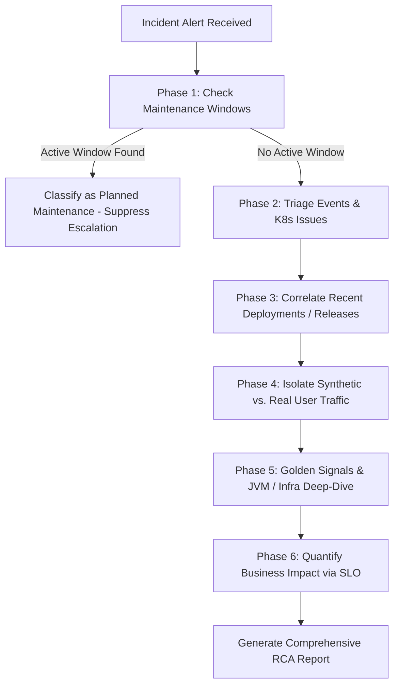

# Instana MCP Diagnostics & Root Cause Analysis Skill

This skill guides LLM agents through diagnosing application incidents, infrastructure saturation, Kubernetes pod failures, and service degradation using the **Instana MCP Server**. It defines how to route tool calls, apply mandatory filters, correlate releases, isolate synthetic traffic, validate maintenance windows, and synthesize high-fidelity RCA reports.

---

## 1. Architecture & Smart Router Calling Rules

The Instana MCP Server consolidates hundreds of REST endpoints into **11 domain-specific Smart Router tools**. Every call requires specifying the `resource_type`, `operation`, and operation-specific `params`.

```
LLM Request ──► [Smart Router Tool] ──► (resource_type + operation) ──► Instana REST Backend
```

### Critical Calling Rules & Filter Constraints:
1. **Mandatory `entity` Field in Tag Filters (`tag_filter_expression`)**:
   - Use `"entity": "DESTINATION"` or `"SOURCE"` when filtering infrastructure/service components (e.g., `service.name`, `container.name`, `kubernetes.namespace`).
   - Use `"entity": "NOT_APPLICABLE"` for call metadata, latencies, synthetic flags, or geo tags (e.g., `call.is_synthetic`, `call.latency`, `endpoint.name`).
   - *Never omit or set `entity` to null—this causes an immediate HTTP 422 error.*
2. **Time Frame Parameters**:
   - Never pass `"to": 0` (which evaluates to Unix Epoch 1970). When querying up to the current moment, **omit the `"to"` field completely** and supply only `"windowSize": <milliseconds>` (e.g., `3600000` for 1 hour).
3. **Avoid Unnecessary Discovery Chaining**:
   - Do **not** call `get_metric_catalog` or `get_services` before querying metrics. Core metric names (`calls`, `errors`, `latency`, `memory.used`, `threads.count`) are static.
   - Calling `get_grouped_calls_metrics` with `groupbyTag: "endpoint.name"` retrieves endpoint names, call counts, error rates, and P95 latency in **one single call**.

---

## 2. The 6-Phase Diagnostic Decision Tree

When an alert or incident investigation begins, execute the following diagnostic workflow in order:



---

### Phase 1: Maintenance Window Check (False-Positive Guardrail)
**Goal**: Check if the affected application or pod is currently undergoing planned maintenance to prevent false alarms.

* **Tool**: `manage_maintenance_windows`
* **Operation**: `resource_type: "window", operation: "list_active"`
* **Request**:
  ```json
  {
    "resource_type": "window",
    "operation": "list_active"
  }
  ```
* **LLM Reasoning Rule**:
  - If `active_windows` contains the service name or application ID: Mark incident status as **`PLANNED_MAINTENANCE`**. Inform the user that downtime or latency is expected and suppress emergency escalation.
  - If no active window exists: Proceed immediately to Phase 2.

---

### Phase 2: Incident & Kubernetes Event Triage
**Goal**: Retrieve Instana's pre-correlated root causes, issue severity, and cluster-level warnings.

* **Step 2A (Instana Correlated Incidents)**:
  - **Tool**: `manage_events`
  - **Operation**: `operation: "get_events"`
  - **Request**:
    ```json
    {
      "operation": "get_events",
      "params": {
        "time_range": "24h",
        "entity_name": "Kubernetes Pod",
        "entity_label": "openshift-tuning/causa-backend-6cccf69c84-rlrrh",
        "max_events": 5
      }
    }
    ```
  - **LLM Reasoning**: Check `severity == 10` (Critical) or `5` (Warning). Extract `probableCause.problem` and `fixSuggestion`.

* **Step 2B (Long-Term Kubernetes Cluster Events)**:
  - **Tool**: `manage_events`
  - **Operation**: `operation: "get_kubernetes_info_events"`
  - **Request**:
    ```json
    {
      "operation": "get_kubernetes_info_events",
      "params": {
        "time_range": "last 24 hours",
        "max_events": 50
      }
    }
    ```
  - **LLM Reasoning**: Bypasses the 1-hour K8s `event-ttl` limit. Inspect `problem_groups` for `OOMKilled` (Exit Code 137), `CrashLoopBackOff`, `PodEvictions`, or `Unhealthy` probe failures.

---

### Phase 3: Release & Deployment Regression Correlation
**Goal**: Determine if a recent CI/CD rollout or code change triggered the failure.

* **Tool**: `manage_releases`
* **Operation**: `operation: "get_all_releases"`
* **Request**:
  ```json
  {
    "operation": "get_all_releases",
    "params": {
      "name_filter": "causa-backend"
    }
  }
  ```
* **LLM Reasoning Rule**:
  - Compare `release.start` timestamp with the incident start time.
  - **Correlation Rule**: If a release occurred within **60 minutes prior** to the incident onset, flag this deployment (version string, commit hash) as the **Primary Suspected Root Cause Trigger** (Regression).

---

### Phase 4: Synthetic Load vs. Organic Traffic Isolation
**Goal**: Determine whether the failure was caused by external probe errors, synthetic test flooding, or genuine user traffic.

* **Scenario A: Is the alert fired directly by a failing synthetic test?**
  - Check `manage_events` for `entityType: "SYNTHETIC_TEST"`.
  - If yes, query `manage_synthetics` (`resource_type: "test_playback", operation: "get_test_summary_list"`):
    ```json
    {
      "resource_type": "test_playback",
      "operation": "get_test_summary_list",
      "params": {
        "payload": {
          "metrics": [{ "metric": "synthetic.metricsStatus", "aggregation": "MEAN" }],
          "timeFrame": { "windowSize": 3600000 }
        }
      }
    }
    ```
  - Inspect `locationStatusList` to pinpoint which regional PoP (e.g., `ap-south-1`) failed and why (DNS timeout, SSL expiration, HTTP 504).

* **Scenario B: Did aggressive synthetic load crash the backend?**
  - Run `manage_applications` grouping by `call.is_synthetic`:
    ```json
    {
      "resource_type": "metrics",
      "operation": "get_grouped_calls_metrics",
      "params": {
        "metrics": [
          { "metric": "calls", "aggregation": "SUM" },
          { "metric": "errors", "aggregation": "SUM" }
        ],
        "group": {
          "groupbyTag": "call.is_synthetic",
          "groupbyTagEntity": "NOT_APPLICABLE"
        },
        "tag_filter_expression": {
          "type": "TAG_FILTER",
          "name": "service.name",
          "operator": "EQUALS",
          "entity": "DESTINATION",
          "value": "causa-backend"
        },
        "time_frame": { "windowSize": 3600000 }
      }
    }
    ```
  - **LLM Reasoning**: If `call.is_synthetic: true` accounts for >80% of total calls or error spikes, attribute the failure to **Synthetic Load Saturation** rather than organic user demand.

---

### Phase 5: Golden Signals & JVM / Infrastructure Deep-Dive
**Goal**: Identify the exact degraded API endpoints and determine if JVM memory leaks, GC pauses, or CPU starvation are present.

* **Step 5A (Endpoint Golden Signals in 1 Call)**:
  - **Tool**: `manage_applications`
  - **Operation**: `resource_type: "metrics", operation: "get_grouped_calls_metrics"`
  - **Request**:
    ```json
    {
      "resource_type": "metrics",
      "operation": "get_grouped_calls_metrics",
      "params": {
        "metrics": [
          { "metric": "calls", "aggregation": "SUM" },
          { "metric": "errors", "aggregation": "SUM" },
          { "metric": "latency", "aggregation": "P95" }
        ],
        "group": {
          "groupbyTag": "endpoint.name",
          "groupbyTagEntity": "NOT_APPLICABLE"
        },
        "tag_filter_expression": {
          "type": "TAG_FILTER",
          "name": "service.name",
          "operator": "EQUALS",
          "entity": "DESTINATION",
          "value": "causa-backend"
        },
        "time_frame": { "windowSize": 3600000 }
      }
    }
    ```
  - **LLM Reasoning**: Calculate `Error Rate % = (errors / calls) * 100`. Identify failing endpoints (e.g. `POST /api/v1/webhooks` with 500 status codes).

* **Step 5B (JVM Time-Series Metrics Curve)**:
  - **Tool**: `manage_infrastructure`
  - **Operation**: `resource_type: "analyze", operation: "get_entities"`
  - **Request**:
    ```json
    {
      "resource_type": "analyze",
      "operation": "get_entities",
      "params": {
        "payload": {
          "type": "jvmRuntimePlatform",
          "metrics": [
            { "metric": "memory.used", "granularity": 600000, "aggregation": "MAX" },
            { "metric": "gc.minor.time", "granularity": 600000, "aggregation": "SUM" },
            { "metric": "gc.major.time", "granularity": 600000, "aggregation": "SUM" },
            { "metric": "threads.count", "granularity": 600000, "aggregation": "MEAN" }
          ],
          "timeFrame": { "windowSize": 3600000 },
          "tagFilterExpression": {
            "type": "TAG_FILTER",
            "entity": "NOT_APPLICABLE",
            "name": "host.name",
            "operator": "CONTAINS",
            "value": "causa-backend"
          }
        }
      }
    }
    ```
  - **LLM Reasoning**: 
    - Continually rising `memory.used` without drops after GC indicates a **Java Memory Leak**.
    - High `gc.major.time` (>1000ms) indicates **Stop-The-World GC Pauses** causing latency spikes and probe timeouts.

* **Step 5C (JVM Startup Flags & Heap Limits - Chained)**:
  - If OOM or memory exhaustion is detected, fetch the JVM snapshot:
    1. Search snapshot: `manage_infrastructure (resource_type: "resources", operation: "get_snapshots", params: { plugin: "jvmRuntimePlatform", query: "causa-backend", size: 1 })`
    2. Read snapshot: `manage_infrastructure (resource_type: "resources", operation: "get_snapshot", params: { snapshot_id: "<id>" })`
  - Extract `data.jvm.args` (e.g. `-Xmx1024m`, `-XX:MaxRAMPercentage=80.0`, `-XX:+UseG1GC`) to verify if container memory limits match JVM maximum heap.

---

### Phase 6: Quantify Business Impact via SLO
**Goal**: Measure error budget burn rate and business SLA violation.

* **Tool**: `manage_slo`
* **Operation**: `resource_type: "report", operation: "get"`
* **Request**:
  ```json
  {
    "resource_type": "report",
    "operation": "get",
    "params": {
      "slo_id": "<slo_id>",
      "var_from": "last 24 hours"
    }
  }
  ```
* **LLM Reasoning**: Extract `sliValue` vs `sloTarget` (e.g. 98.2% vs 99.5%), `remainingErrorBudgetPercentage`, and `burnRate`. If burn rate > 2.0x, flag as **Urgent SLA Breach**.

---

## 3. RCA Report Synthesis Framework

When presenting the final Root Cause Analysis to the user or writing to Causa's diagnostic record, do consider these things. 

```markdown

### Failure Timeline & Correlation
- **Incident Start**: `<timestamp>`
- **Recent Deployment**: `<Release tag / None>` (Deployed at `<timestamp>`)
- **Maintenance Status**: `<Active Window / None>`
- **Traffic Origin**: `<Real User Traffic (XX%) vs. Synthetic Probe Load (XX%)>`

### Deep-Dive Diagnostic Telemetry
- **Kubernetes Events**: `<OOMKilled / CrashLoopBackOff details>`
- **Degraded Endpoints**: `<Endpoint name, Call volume, Error Rate %, P95 Latency>`
- **JVM & Runtime State**: `<Heap Used vs Max, GC Pause duration, -Xmx flags>`
- **SLO Impact**: `<Current SLI %, Error Budget remaining %, Burn Rate>`

### Actionable Remediation Steps
1. **Immediate Action**: `<e.g., Roll back release v1.4.2 OR Increase pod memory limit to 2Gi>`
2. **Configuration Fix**: `<e.g., Set -XX:MaxRAMPercentage=75.0 in deployment env vars>`
3. **Long-Term Preventive**: `<e.g., Add memory leak regression tests for POST /api/v1/webhooks>`
```

---

## 4. Excluded Tools & Operations Reference

Do **NOT** call these tools during backend RCA (they waste tokens with zero diagnostic return):

| Excluded Tool / Operation | Reason for Exclusion |
|---|---|
| `manage_automation` | Remediation script orchestration, not root-cause diagnosis. |
| `manage_websites` | Browser EUM/RUM telemetry is irrelevant for backend/JVM microservices. |
| `manage_mobile_apps` | Mobile beacon data is irrelevant for Kubernetes workloads. |
| `manage_custom_dashboards` | UI layout CRUD operations provide no runtime diagnostic value. |
